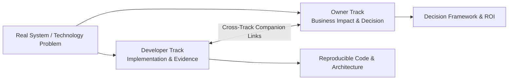

# Publication Overview

Welcome to **Content Pipeline Docs**—an independent technical publication explaining how technology, automation, and content systems work in real-world practice.

This publication is built on a simple thesis: **good software decisions require both rigorous technical evidence and practical business clarity.**

To serve that standard, every topic in this publication is examined through two complementary tracks:

1. **Developer-Oriented Articles** — For engineers, architects, and technical leaders who need implementation details, architecture diagrams, verified schemas, benchmark methodologies, trade-offs, and failure cases.
2. **Owner-Oriented Articles** — For business owners, founders, and non-technical decision-makers who need clear frameworks for options, costs, risks, maintenance liabilities, and strategic recommendations.

---

## The Two Editorial Tracks

### 1. Developer-Oriented Research

These articles explain what was built or tested and what the evidence actually demonstrated. They dive into TypeScript workflows, API integrations, database schemas, prompt pipelines, and error-recovery routines.

Every developer article follows a disciplined 10-part structure:

1. **Title** — What was built or tested, explicitly naming the core technology.
2. **Short Answer** — Immediate conclusion in two to three sentences with concrete numbers.
3. **Target Audience** — Who should find this useful, assumed technical prerequisites, and a companion link to the owner perspective.
4. **The Problem** — The operational or technical problem being solved.
5. **Approach & Architecture** — The design choices, component responsibilities, and architectural diagrams.
6. **Implementation** — Realistic code and configuration, with expected console or database output placed directly below each step.
7. **Results & Measurements** — Methodology, test environment, and reproducible observations.
8. **Challenges & Trade-offs** — What failed during implementation, what was redesigned, and what was intentionally not optimized.
9. **When to Avoid & Limitations** — Explicit boundary conditions, untested scenarios, and known weaknesses.
10. **Repository & Next Steps** — Source code references, reproduction commands, and open questions.

Developer articles strictly distinguish between **observed results** from tests, **implementation facts** from code, and **interpretations or personal recommendations**.

### 2. Owner-Oriented Decision Frameworks

These articles translate technical realities into strategic decisions for business leaders. They avoid unnecessary jargon while preserving technical accuracy, answering the central question:

> *"Which option is appropriate for this specific situation, with these constraints and this level of risk?"*

Every owner article follows an actionable decision structure:

1. **Title** — The specific trade-off or business choice.
2. **Short Answer** — Executive recommendation and who it applies to.
3. **Why This Decision Is Hard** — The realistic business stakes, budget constraints, and operational scenarios.
4. **What This Is Based On** — Working systems, pricing research, empirical testing, and companion technical links.
5. **Options Compared** — Objective analysis of Option A versus Option B, including sweet spots and primary risks.
6. **Comparison Matrix** — Side-by-side comparison across upfront cost, maintenance overhead, flexibility, failure risk, and switching difficulty.
7. **Decision Framework** — Explicit, rule-based heuristics (*"Choose A if X; Choose B if Y"*).
8. **Clear Recommendation** — A definite default choice with explained exceptions.
9. **Limitations of This Analysis** — Assumptions, scale limits, and contexts where the recommendation does not apply.
10. **Final Takeaway** — A single actionable sentence.

---

## Shared Evidence Standards

Across both tracks, Content Pipeline Docs enforces strict editorial standards:

- **Problems First, Tools Second:** We start with a genuine operational problem or workflow bottleneck rather than vendor marketing buzzwords.
- **Measurable Claims:** Performance metrics, latency figures, and costs are documented with their specific measurement context—not presented as universal truths.
- **Visible Limitations:** We explicitly state what an approach *cannot* do, where it breaks down, and when a simpler solution (such as a spreadsheet or manual process) is preferable.
- **Honest Trade-offs:** We do not hide behind generic "it depends" conclusions; we specify the exact conditions under which one choice outperforms another.

---

## Core Subject Areas

The publication currently covers three core thematic categories:

### Case Studies
In-depth examinations of production workflows. The flagship case study explores a human-gated AI content pipeline:
- [Developer Implementation: How I Built a Human-Gated AI Content Pipeline for an Open-Source Directory](/docs/developer-oriented-articles/case-studies/articled1)
- [Owner Strategy: Should Your Business Use AI to Maintain a Software Directory?](/docs/owner-oriented-articles/case-studies/articleo1)

### Technology Comparisons
Direct evaluations between architectural paradigms and tooling approaches:
- **Spreadsheets vs. Dedicated Tools:** [Developer Evaluation](/docs/developer-oriented-articles/comparisons/developer-spreadsheet-right-tool) | [Owner Decision](/docs/owner-oriented-articles/comparisons/owner-spreadsheet-right-tool)
- **Build vs. Buy / Hiring vs. Tools:** [Technical Evaluation Method](/docs/developer-oriented-articles/comparisons/developer-hire-developer-or-buy-tool) | [Hiring vs. Buying Software](/docs/owner-oriented-articles/comparisons/owner-hire-developer-or-buy-tool)
- **Evaluating Tech Without Reading Code:** [Engineering Audit Guide](/docs/developer-oriented-articles/comparisons/developer-choose-technology-without-code) | [Non-Technical Evaluation Framework](/docs/owner-oriented-articles/comparisons/owner-choose-technology-without-code)

### Business & Process Decisions
Engineering and operational frameworks for teams:
- **Process Automation Viability:** [Engineering Criteria](/docs/developer-oriented-articles/business-decisions/developer-automate-processes) | [Strategic Prioritization](/docs/owner-oriented-articles/business-decisions/owner-automate-processes)
- **Negative-ROI Automation:** [Detecting Excess Maintenance](/docs/developer-oriented-articles/business-decisions/developer-automation-more-work) | [When Automation Creates More Work](/docs/owner-oriented-articles/business-decisions/owner-automation-more-work)
- **Vendor Lock-In Risks:** [Measuring Portability](/docs/developer-oriented-articles/business-decisions/developer-vendor-lock-in) | [Supplier Dependence Risks](/docs/owner-oriented-articles/business-decisions/owner-vendor-lock-in)
- **Single Source of Truth:** [Architecture Without Data Drift](/docs/developer-oriented-articles/business-decisions/developer-single-source-of-truth) | [The Business Case](/docs/owner-oriented-articles/business-decisions/owner-single-source-of-truth)
- **Team Knowledge Retention:** [Engineering Retention Systems](/docs/developer-oriented-articles/business-decisions/developer-lose-knowledge) | [Why Fast Teams Lose Knowledge](/docs/owner-oriented-articles/business-decisions/owner-lose-knowledge)
- **Small Team Process:** [Lightweight Engineering Process](/docs/developer-oriented-articles/business-decisions/developer-process-small-team) | [How Much Process Is Enough?](/docs/owner-oriented-articles/business-decisions/owner-process-small-team)
- **Cost of Rewriting Information:** [Measuring Repeated Work](/docs/developer-oriented-articles/business-decisions/developer-real-cost-rewriting) | [The Real Business Cost](/docs/owner-oriented-articles/business-decisions/owner-real-cost-rewriting)
- **Tooling TCO:** [Instrumenting Tool Value](/docs/developer-oriented-articles/business-decisions/developer-measure-tool-cost) | [Measuring Full Tool Cost](/docs/owner-oriented-articles/business-decisions/owner-measure-tool-cost)

---

## Navigating the Publication

- Use the **sidebar** to navigate by track and category.
- When reading any article, look for the **companion callout** near the top to read the counterpart analysis from the alternative perspective.
- View the source repository and reproducibility instructions at [github.com/Dineshwev/content-pipeline-docs](https://github.com/Dineshwev/content-pipeline-docs).
